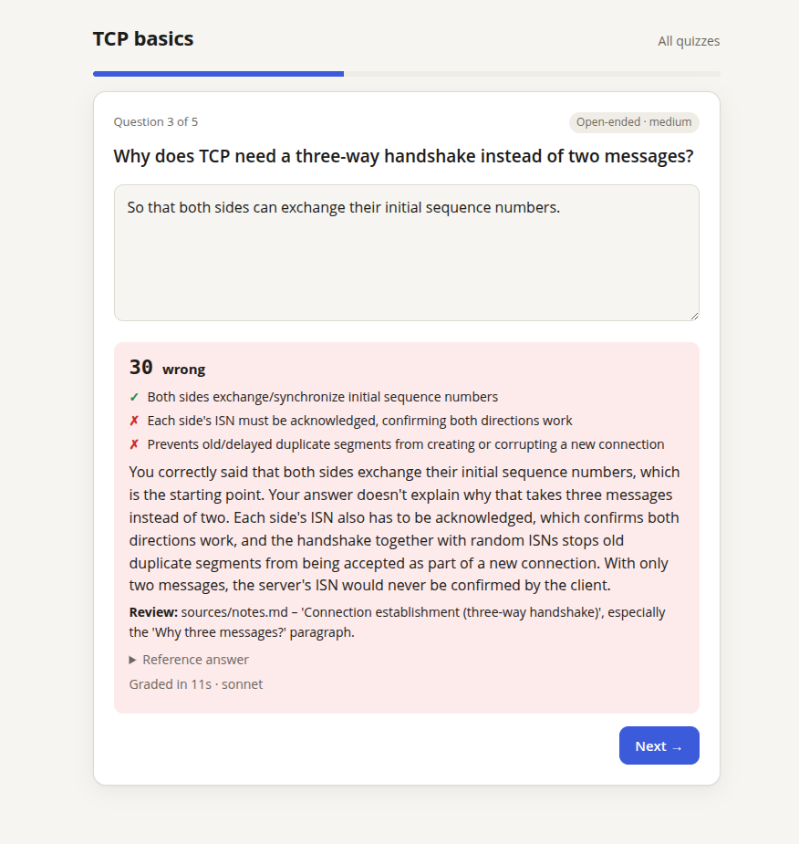

# study-quiz

A [Claude Code](https://claude.com/claude-code) plugin that turns a topic, your notes,
files or URLs into an interactive study quiz:

- **Multiple-choice flashcards** with instant right/wrong feedback and explanations.
- **Open-ended questions graded by Claude**: a score, which key ideas you hit or
  missed, feedback, and what to re-read, checked against your own study material.
- **Review loop**: past attempts are saved, and `from mistakes` builds a new quiz
  that targets your weak spots.

Everything runs locally through **your own Claude Code login**. Quiz generation
happens in your Claude Code session, and grading runs headless `claude -p` in the
background. You don't need an API key, and nothing is uploaded except what Claude
Code itself sends to Claude.



## Requirements

- Claude Code, logged in (`claude`, then `/login`)
- Python 3.9+ (standard library only; nothing to `pip install`)

## Install

In Claude Code:

```
/plugin marketplace add erick-tmr/study-quiz
/plugin install study-quiz@study-quiz
```

Update later with `/plugin marketplace update study-quiz`.

## Usage

```
/study-quiz:quiz the TCP three-way handshake and congestion control
/study-quiz:quiz ~/notes/biology/cell-cycle.md n=15
/study-quiz:quiz https://en.wikipedia.org/wiki/Raft_(algorithm) mix=4mc/4open
/study-quiz:quiz from mistakes tcp-basics
```

Claude writes the quiz, starts the local server if it isn't running, and gives you a
link like `http://localhost:8765/quiz/tcp-basics`. Open it, answer the questions, and
type open answers in your own words. Grading takes about 15–40 seconds per answer.

You can also run the server yourself:

```
python3 ~/.claude/plugins/…/study-quiz/server/server.py   # path shown by /plugin
```

## Where things live

```
~/study-quizzes/            # override with STUDY_QUIZ_DIR
  <slug>/
    sources/                # the material the quiz (and the grader) is based on
    quiz.json               # questions, answers, reference answers, key points
    attempts.json           # your answers and grades, appended by the server
```

Your quizzes and answers stay in this folder. Edit `quiz.json` by hand if a question
is wrong.

## Configuration

| Variable | Default | Meaning |
| --- | --- | --- |
| `STUDY_QUIZ_DIR` | `~/study-quizzes` | Quiz workspace |
| `STUDY_QUIZ_GRADER_MODEL` | `sonnet` | Model alias used for grading (`haiku` is faster, `opus` more nuanced; `""` uses your Claude Code default) |
| `STUDY_QUIZ_PORT` | `8765` | Server port |
| `STUDY_QUIZ_CLAUDE` | `claude` on `PATH` | Path to the Claude Code binary |

## How grading works

1. When a quiz is created, each open question gets a reference answer and 2–5
   **key points**, the atomic ideas a full-score answer must contain.
2. When you submit an answer, the server runs
   `claude -p … --plugin-dir <this plugin> --tools Skill,Read,Glob,Grep --json-schema …`
   in your quiz workspace. That is a read-only, headless Claude Code session that
   follows the [`grade` skill](skills/grade/SKILL.md).
3. The grader reads the question, the relevant `sources/` and your earlier attempts.
   It marks each key point as hit or missed, and returns JSON that matches
   [`grade.schema.json`](server/grade.schema.json).
4. The server appends the result to `attempts.json` and the page shows it.

Grading uses your Claude plan's usage, like any other Claude Code message. The
server listens on `127.0.0.1` only and rejects cross-site and DNS-rebinding requests.

## Customising

The behaviour lives in two plain-Markdown skills: [`skills/quiz`](skills/quiz/SKILL.md)
(generation rules) and [`skills/grade`](skills/grade/SKILL.md) (the rubric). Fork the
repo, edit them, and install your fork the same way.

For local development, without installing:

```
claude --plugin-dir ./study-quiz
```

## Versioning

Releases follow semver. The version is in
[`.claude-plugin/plugin.json`](.claude-plugin/plugin.json), each release is tagged
`vX.Y.Z`, and changes are listed in [CHANGELOG.md](CHANGELOG.md).

## License

[MIT](LICENSE)
